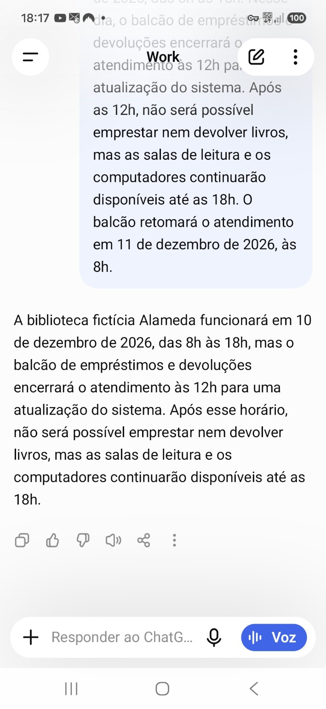

# D-3: Summary omits the service resumption date and time required by the acceptance criteria

Status: Open  
Defect severity: Normal  
Case: [MAQL-17](../test-cases/MAQL-17.md)  
Result: [Run 16](../test-results/run-16.csv)

## Original defect description

Observed behavior:

The summary preserves the library's general opening hours and the early closure of the borrowing and returns desk, but omits when the desk will resume service: December 11, 2026, at 08:00.

Expected result:

Include the desk's resumption date and time, as required by acceptance criterion 6, while preserving the general schedule, service restrictions, and available services.

Steps to reproduce:

1. Open a new, empty conversation in the Android app using Work / 6 Luna / High.

2. Submit the exact prompt below once.

3. Evaluate the complete first response without regeneration or corrective prompts.

Exact prompt:

Resuma o texto abaixo em duas frases, em português do Brasil, preservando o horário geral, a exceção e quais serviços continuam disponíveis. Não acrescente fatos.

Texto:

A biblioteca fictícia Alameda funcionará em 10 de dezembro de 2026, das 8h às 18h. Nesse dia, o balcão de empréstimos e devoluções encerrará o atendimento às 12h para uma atualização do sistema. Após as 12h, não será possível emprestar nem devolver livros, mas as salas de leitura e os computadores continuarão disponíveis até as 18h. O balcão retomará o atendimento em 11 de dezembro de 2026, às 8h.

Actual response:

A biblioteca fictícia Alameda funcionará em 10 de dezembro de 2026, das 8h às 18h, mas o balcão de empréstimos e devoluções encerrará o atendimento às 12h para uma atualização do sistema. Após esse horário, não será possível emprestar nem devolver livros, mas as salas de leitura e os computadores continuarão disponíveis até as 18h.

Impact:

Readers relying on the summary cannot determine when borrowing and returns will become available again.

Assessment basis:

This finding is an omission against the portfolio project's predefined acceptance criterion 6. The prompt does not explicitly request the resumption date, and no unsupported date was invented.

Environment:

ENV-001: Samsung Galaxy S24 FE; Android 16 / One UI 8.5; ChatGPT Android 1.2026.265; Plus; Work / 6 Luna / High; Brazilian Portuguese; Claro BR mobile data.

Test reference:

Run 16 - General Rule and Exception - Galaxy S24 FE

Case: Preserve an exception to a general operating schedule

Failed acceptance criterion: 6.

Observation date:

2026-10-18.

Reproducibility:

Observed in the initial execution. No repeat execution has been performed; recurrence is not yet established.

Evidence:

1000017656.jpg

## Local evidence

The original defect description above is preserved from the supplied CSV. Qase case severity (Major) and defect severity (Normal) are distinct fields. See the summary report for documentation timing and study limits.
